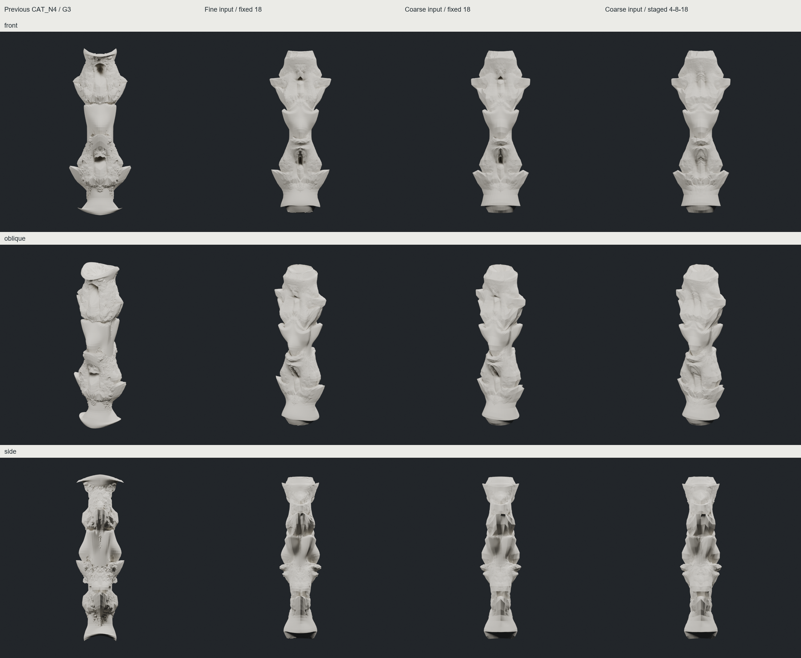

# Column development — 깊은 접힘과 초기 표면 변화의 순서

**부분 개선. 대표 비교안은 SPAN_RETURN_FINE, 다음 성장 시험용 비교안은 SPAN_RETURN_COARSE다.** 형상장 이동을 낮추고 기존 되접힘을 세대별로 넣자 큰 골과 안쪽 반환이 먼저 읽혔다. 이 성과는 CHESHIRE 접힘 연산을 명시적으로 추가한 결과이며, Mandelbulb가 스스로 새 접힘을 발달시킨 것으로 주장하지 않는다.

| 비교 | 실제 얻은 것 | 남은 한계 / 판정 |
|---|---|---|
| 초기 SPAN·WEAVE·COUNTER 및 R1 | 비례·방향·마디 관계와 입체적인 끝면 시험 | 새 접힘의 단순 중첩은 둥근 블록과 좁은 목의 반복으로 읽혀 성장 출발점으로 보류 |
| R2 초기 매스 | 확보했던 깊은 cup 구성으로 복귀. 비례와 마디 위치 변경, 끝면 내부 제어점과 방사 방향 반환 확보 | 얇은 기단·주두 판은 완화했지만 두꺼운 cuff와 끝마개 인상이 일부 남음 |
| SPAN_N4_COARSE / REFINED | 동일 입력·필드·이동량에서 목표 격자만 비교 | 정밀 목표가 더 가까워졌어도 거친 피막은 남음. 수치 개선과 조형 개선을 구분 |
| WEAVE_BRIDGE4_REFINED | 중간 몸통까지 세 형상장이 겹침 | 피막과 독립 덩어리 인상이 강함. 후속 우선도 낮음 |
| **SPAN_RETURN_FINE** | 약한 field + 방향별 깊은 return. 사선 곡면과 골의 연결이 가장 연속적 | 국소 crust와 반복 cup 위계가 남음. 대표 비교안으로 보존 |
| **SPAN_RETURN_COARSE** | 같은 설계를 성긴 제어망에서 시작. 초기 미세 패턴이 약하고 큰 반환이 먼저 읽힘 | 넓은 다면체 패널과 꺾임이 G3까지 남음. 입력은 같은 식의 다른 샘플링이며 동일 메시가 아님 |
| SPAN_RETURN_STAGED | COARSE와 같은 조건에서 판정 반복 4→8→18 | 골 일부가 메워지고 새로운 위계의 이득이 작음. 단계화 자체를 해법으로 추천하지 않음 |

[G1/G2 초기 패턴 비교](images/return_early_pattern_comparison.png) · [FINE G0–G3](images/SPAN_RETURN_FINE_progression.png) · [COARSE G0–G3](images/SPAN_RETURN_COARSE_progression.png) · [입력 매스 9개](images/input_front_overview.png) · [목표 격자 비교](images/span_target_comparison.png).

## 무엇을 바꿨는가

입력은 기존 smooth_deep의 부호 있는 반경·축 방향 PCHIP 반환과 깊은 골 구성을 재사용했다. 축 위치를 재배치하고 높이별 기준 반경을 바꿨다. 기존 quad carrier를 접기 전에 bilinear 분할해 끝면 내부를 샘플링했다. 단순한 평평한 cap 대신 오목한 축 단면과 방사 반환을 넣었다. 별도 shell, XYZ smoothing, CC 좌표 평균화는 없다.

성장 세대마다 실제 quad를 4개로 분할하고 기존·신규 제어 정점에 형상장을 적용했다. 마지막 세 조건의 field fraction은 .55에서 .18로 낮췄고, G1/G2/G3에 서로 다른 방향·높이의 기존 PCHIP return을 추가했다. 반환 깊이는 .38/.30/.22이며 단위는 입력 높이 10과 같은 좌표 단위다. field step 상한 .35/.28/.22는 field 이동만의 상한이며 추가 return과 합친 총 이동의 상한이 아니다. 두 변위를 별도로 저장했다.

FINE의 제어면은 6,400→25,600→102,400→409,600개, COARSE는 1,600→6,400→25,600→102,400개다. G3 렌더·검사 표면은 각각 1,638,400 / 409,600개 삼각형이다. 입력 준비의 분할과 후속 성장 G1–G3, 형상장 내부 판정 횟수는 별개다.

## IAAC 근거와 한계

[IAAC 공개 설명](https://www.iaacblog.com/programs/mesh-subdivision/)은 초기 geometry와 subdivision depth, 추가 attractor curves를 디자인 변수로 다룬다. [단계별 도판](https://www.iaacblog.com/wp-content/uploads/2020/12/pres112.png)의 초반에는 넓고 긴 골과 면이 읽힌다. 우리 G1은 그보다 작은 피막이 일찍 지배했지만, 입력·해상도·필드·렌더 조건이 달라 같은 세대 번호를 동등한 조건으로 비교할 수는 없다.

우리의 구면 거듭제곱 Mandelbulb와 수치 설정은 공개 흐름의 재구성이다. 원본 방정식이나 attractor 작용식을 복원했다고 주장하지 않는다. 정밀 목표와 판정 반복 단계화도 우리의 비교 가설이다. 낮은 판정 횟수는 저역통과 필터가 아니라 더 큰 finite inside 영역을 만들 수 있으며, inside-only 이동은 앞선 변형의 영향을 남길 수 있다. [2,4,8]은 2회 판정에서 기존 축격자의 outside subset이 없어 실행하지 않았다. 범위를 확장하지 않고 [4,8,18]을 사용했다.

## 핵심 검사와 보존

FINE·COARSE G3만 최종 핵심 검사했다. 두 안 모두 실제 X/Y 기하 반사와 반사 삼각형 집합이 일치하고 오차는 5.46e-15 이하다. 연결체 1개, 폐합, 경계·비다양체 변 0, winding 일관이다. 최소 면적은 각각 2.59e-7 / 2.15e-6으로 기존 1e-12 기준을 통과했다.

**두 안 모두 CGAL 자기교차가 확인됐다.** 최초 증거만 확인했고 전체 수는 계산하지 않았다. 다른 안의 자기교차는 미검사다. 두께·물리적 접힘·구조·제작 가능성은 미검증이다. [검사 기록](technical/final_validation.json).

실제 메시·체크포인트·렌더·Blender 장면 27개는 `E:/CHESHIRE_DATA/column_development_20261011/`에 보존했다. OBJ는 생성하지 않았다. 기존 카탈로그와 코드도 보존했다. [실제 파일 위치](INDEX.json) · [세대별 설정](technical/development_index.json) · [코드](../../experiments/column_development_20261011/README.md).

다음 시험은 FINE을 기준으로 새 field 변위를 골·능선의 가이드에 맞춰 연동하고, 큰 접힘이 읽힌 뒤 선택 영역에서 세부 변형을 활성화하는 것이다. XYZ 전체를 평활화하거나 기존 접힘을 고정하는 방식으로 해결하지 않는다. 이 후속 조합은 아직 별도 시험 중이다.
