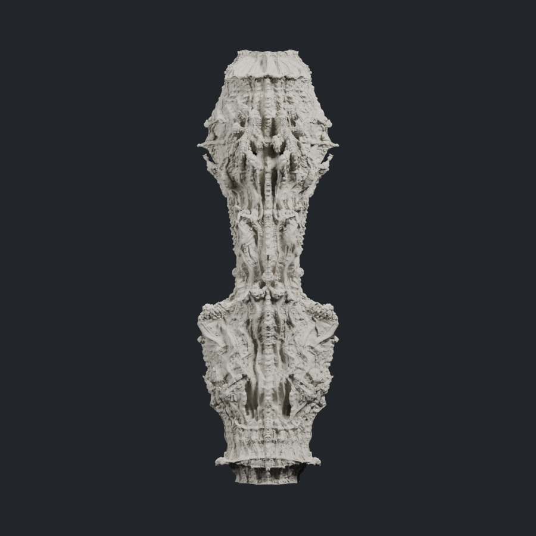

# Retained column pipeline — 2026-10-17

The existing **G7 generation-mirror hybrid** is the retained working baseline.
This checkpoint preserves its process, executed source bundle, parameters,
validation receipts and preview. It does not regenerate or replace the column.

The user deferred early-form overlap and the shortened G5 finishing route.
Those experiments remain separate research records and are not the baseline.
No further generation is part of this preservation update.



## Retained process

| Step | Retained operation |
| --- | --- |
| G0 | Original SPAN input: 25 rings, 16 sectors, radius .78 |
| G1–G2 | Original Task36 splits, finite Mandel fields and authored returns |
| G3–G4 | Measured WALL, ROOT and SIDEWALL topology, then neutral refinement |
| G5 | Original DIRECTIONAL subdivision |
| G6 | Original DEPTH08 subdivision and MIDDLE field |
| G7 surface | Actual neutral CC from G6 MIDDLE |
| NESTED underlay | Retained primary MIDDLE weighting, CHILD and SMALL folds |
| Hybrid finish | Generation-history classification; coarse Mandel on G6; paired actual CC differential; paper-derived Tissue height; fresh fine Mandel; protected-flow recovery |

The selected NESTED route intentionally replaces the earlier LINKED/WIDE and
global micro-FLOW combination. Applying all historical alternatives in sequence
would not reproduce the retained result.

The authoritative order, executed source hashes and exact stage receipts are in
[frozen_baseline_manifest.json](frozen_baseline_manifest.json). The main final
driver is [run_generation_mirror_hybrid_20261016.py](../../experiments/run_generation_mirror_hybrid_20261016.py).

## Preserved result and reproduction materials

The original full model remains at:

```text
E:/CHESHIRE_DATA/exports/20261016/COLUMN_GENERATION_MIRROR_HYBRID/CHESHIRE_COLUMN_G7_GENERATION_MIRROR_HYBRID_FULL.ply
```

It contains 14,004,226 vertices and 28,008,448 native triangles (700,211,493 bytes).
Its recorded SHA256 is:

```text
ed40809e09ac8afd0a4be6369ada572add7b2dd24fb71aaad7b63be7481363ef
```

- [Executed algorithm bundle](algorithm/CHESHIRE_GENERATION_MIRROR_PIPELINE_PROTOTYPE.zip)
- [Algorithm manifest](algorithm/ALGORITHM_BUNDLE_MANIFEST.json)
- [Original full model readback](provenance/export/MODEL_READBACK.json)
- [Original hybrid geometry checks](provenance/hybrid/GEOMETRY_QUALITY.json)

The bundle includes the executed helpers that originally lived on E:, including
history classification, paper-component preparation and Tissue mapping. Frozen
large model/checkpoint arrays remain external and are identified by paths and
hashes. This is preservation of the recorded workspace, not a newly verified
portable replay on another computer. Existing output directories must remain
read-only; use fresh output roots for any later authorized experiment.

Run the small preservation tool only to a **fresh** destination:

```powershell
python -B -X utf8 tools/preserve_column_pipeline_20261017.py --output NEW_PRESERVATION_FOLDER
```

The tool verifies small copies, archive CRC/member hashes and current executed
source bindings. It does not rebuild geometry or rehash the 700MB model; the
model digest is retained from its original receipt and complete readback proof.

## Deferred work

Early dynamic variants, structural-grammar alternatives, inherited-layout
variants, two-mass overlap and selective-overlap studies remain under their
dated `experiments/` directories. The 193-ring G5 prototype is archived as a
separate experiment; it does not supersede this original G7 process. The proposed
new 25/49-ring overlap replay was stopped before generating a model.

Optional reusable ornament/assembly APIs and their tests are preserved alongside
the project. Their availability does not change the selected baseline operator
sequence.

## Verification scope

This preservation run verified 39 small copied artifacts, the original bundle's
CRC and 96 listed member hashes, and 94 current executed-source bindings. The
three reusable-API test files passed all 13 tests. No large geometry was rerun.

The original result's rendered native fans and full PLY readback passed their
recorded checks. An auxiliary alternate-diagonal audit has separate failures;
global self-intersection and fabrication certification remain unclaimed. See the
preserved original receipts for their exact scope.
