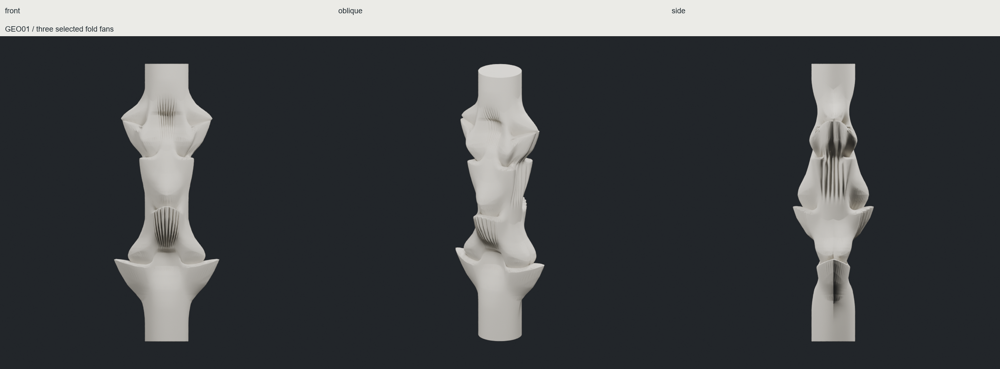
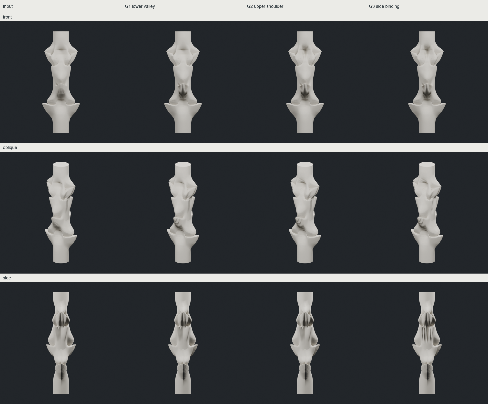

# CHESHIRE — 깊은 골과 방향성 접힘

**현재 추천은 GEO01 G3, 대안은 GEO02 G3다.** 부드러운 큰 접힘 안에 방향과 규모가 다른 주름을 배치했다. 원본·실패안·유망안은 모두 보존했다. 기둥은 실제 메시이며, 제작 모델로 검증된 상태는 아니다.

| 후보 | 얻은 것 | 남은 한계 |
|---|---|---|
| W06 | 깊은 골과 기존 위치를 유지하면서 능선·입술선 완화 | 일부 몸체는 여전히 조용하고 접점에 잔요철·교차가 있음 |
| **GEO01 G3** | 아래 골 → 위 어깨 → 측면 결속에 주름을 순차 추가. 부위별 방향·간격 차이 | 아직 새로운 큰 형상 위계까지 생긴 것은 아님 |
| **GEO02 G3** | 중앙 골을 피해 갈라지는 대각선 주름 | 사선에서 유연하지만 일부 작은 주름의 가시성이 약함 |
| GEO03 | 기존 return 단면을 주름 옆에 재사용 | GEO01보다 시각적 진척이 작아 리드로 올리지 않음 |
| F_V04 / F_W06 | 강한 입력에 subdivision과 필드 성장 적용 | 암석 같은 각진 요철, 골 주변 교란, 최소 면적 검사 실패 |

[전체 후보 비교](images/final_geometric_comparison.png) · [각진 입력과 부드러운 입력](images/soft_vs_angular.png) · [이전 A에서 현재까지](images/older_to_current.png)

## 반복 후 형태 보존

GEO01/02는 선택된 세 구역을 차례로 변형했다. 좌표 평균화나 별도 smoothing은 없다. 아래·위 골 중심선 66/70개 정점의 이동은 각각 **0**이다. 앞 세대 주름의 보호 핵심부도 G3까지 이동 **0**이다. 좌표 보존을 접힘 각도·길이 보존이나 전체 골의 불변으로 해석하지 않는다.

사용자가 표시한 기존 세로 줄에는 삼각형 보간 요철이 섞여 있었다. 원래 표면을 보존한 대조군과 실제 산·골을 두 강도로 추가한 안을 분리했다. GEO01/02는 그 원리를 세 부위에 적용했다. 물리적 압축 주름이나 origami solver는 구현하지 않았다.

[표시 부위 확대](images/valley_pleats_detail.png) · [실제 메시 단면](images/current_actual_sections.png)

## IAAC에서 적용한 것

[IAAC 공개 과정](https://www.iaacblog.com/programs/mesh-subdivision/)에는 프랙탈 영역의 안팎에 따른 이동과 외부 격자점 탐색이라는 두 방식이 있다. 정확한 수식·계수·충돌 처리는 확인된 자료만으로 동일하게 재현할 수 없다.

F 비교는 기존 CHESHIRE의 유한 Mandelbulb 판정과 외부 격자 탐색을 재사용했다. **삼각형 중점 subdivision 1회 + 필드 이동 2회**이며 두 번째 이동의 해상도는 고정했다. 보호 좌표는 약 1e-15 이내로 남았지만 주변 면의 변화로 골이 다르게 읽혔다. 정점 보존만으로 형태 보존을 판단할 수 없다는 결과다. ASTRA의 후반 수렴 기록도 검토했으며 이번 후보에 ASTRA 연산을 실행했다고 주장하지 않는다.

[부드러운 입력의 성장](images/W06_SYMMETRIC_SMOOTH_field_progression.png) · [각진 입력의 성장](images/V04_SYMMETRIC_CUP_field_progression.png)

## 핵심 검증

- W06, GEO01/02/03: X/Y 반사 오차 ≤ **3.85e-15**, 반사 삼각형 집합 일치. 단일 연결체, 폐합, 경계·비다양체 변 0, winding 일관.
- **모두 자기교차 확인.** 주름 추가 전 입력과 국소 골 패치에서도 교차가 있었다. 추가 주름이 교차를 늘리지 않았다는 증명은 하지 않았다.
- GEO01/02/03 최소 삼각형 면적 **1.47e-12**, 기존 **1e-12** 기준 통과. F G2는 **2.84e-13 / 3.09e-13**로 실패했고 기준을 바꾸지 않았다.
- V03/W01의 골 추가 함수에서 앞뒤 대칭 오차가 발견됐다. 원본을 보존하고 정면을 반사해 V04/W06을 생성했다. 정점 평균화는 하지 않았다.
- 두께·구조·제작 가능성·물리적 접힘 경로는 미검증. 폐합은 자기교차 없음이나 제작 가능한 solid를 뜻하지 않는다.

**판정: 부분 채택.** 현재는 부위별 접힘 관계가 살아 있는 GEO01/02를 유지한다. 전면 필드 성장의 복잡성을 미적 성공으로 포장하지 않는다. 다음 조절 대상은 ① 주름 폭·깊이·방향, ② 큰 접힘 옆 작은 return의 위치·순서다.

실제 메시·체크포인트·Blender 장면: E:/CHESHIRE_DATA/curved_fold_side_20261011/. [위치 목록](INDEX.json), [상세 기록](technical/), [연구 구분](../../experiments/curved_fold_side_20261011/RESEARCH.md). 브랜치 experiment/curved-fold-side-20261011, 로컬 보존 상태.
