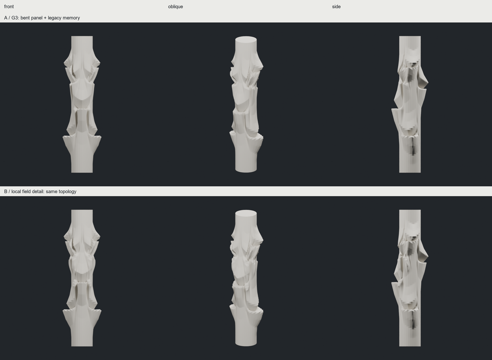

# CHESHIRE — Directional Fold Memory Study

**판단: A의 선택적 방향 개입과 위치 기억은 부분 채택. B의 디테일 증가는 이번 결과에서 조형적 우위가 없다.**

접힘의 위치·크기는 유지하고, 둥근 팽창 단면을 안쪽으로 꺾였다가 돌아나오는 단면으로 바꿨다. 부푼 인상은 줄었지만, 입술의 뾰족함·톱니 경계와 측면의 분절이 남았다. 참조 이미지의 매끄럽고 결합된 면 전환을 구현했다고 평가하지 않는다.

| 결과 | 얻은 것 | 잃거나 남은 것 |
|---|---|---|
| A: A_FOLD/G03 | 방향별 높이가 어긋나는 입술·골, 이전 접힘을 남긴 사선 어깨 개입 | 날카로운 경계, 일부 넓은 면과 민짜 몸통, 상부 자기교차 |
| B: B_LOCAL/G01 | 기존 접힘 어깨에만 작은 변형 공존, 보호 영역 유지 | 주름보다는 거친 얕은 변형으로 읽히는 부분. A보다 설득력 있다는 근거 부족 |

## 실제로 구현한 것

- 기존 25×32 폐합 원통 carrier와 Task33 bilinear 분할 재사용. 원본 연산은 수정하지 않았다. CC 좌표 평균화와 별도 smoothing은 모두 사용하지 않았다.
- A G1: 좌우 방향의 아래·위 사건. G2: 앞·뒤의 서로 다른 높이 사건. G3: 앞쪽 사선 어깨 사건. 방향과 축 위치, 팽창·결속·재팽창, 축 방향 return, 겹침 폭을 분리했다.
- 유한한 꺾인 단면 프로파일과 방향별로 달라지는 입술 높이로 실제 정점을 이동했다. 단순 방사형 돌출뿐 아니라 재료 높이가 증가하는데 실제 Z가 감소하는 구간도 있다.
- 생성한 능선·골·입술 띠를 태그로 저장하고 후속 분할에 전달했다. 중심 띠는 다음 변위에서 고정하고, 주변 띠는 점진적으로 감쇠했다. 자동 crease 검출은 아니다.
- B는 A3와 정확히 같은 토폴로지를 쓴다. 기존 finite Mandelbulb escape 신호를 앞쪽 연결부·사선 어깨의 제한된 band 안에서 법선 변위로 사용했다. 실제 control 정점 11.83%, 물리 메시 정점 12.36%가 변했다.

## 이미지에서 읽히는 것과 구현의 한계

A1의 아래·위 입술은 A3와 B에서도 남는다. 앞과 옆의 접히는 높이가 달라 원형 마디 적층보다 방향 차이는 분명하다. 다만 정면에서는 컵형 사건의 반복이 일부 남고, 측면의 면 전환은 거칠다. B는 전체 실루엣을 거의 유지하지만, 국소 표면 발달만으로 접힘의 설득력을 높이지 못했다.

저장한 다섯 feature의 기준 정점 1,982개는 생성 당시부터 B까지 위치 변화가 0이다. 이는 **위치 기억**의 결과이지 접힘 각도 불변의 증거가 아니다. 같은 토폴로지인 A2→A3에서도 주변 면의 변화로 보호 띠의 이면각 분포는 달라졌다. 실제 종이 folding, 면의 비신축성·전개 가능성·패널 간 역학은 구현하지 않았다.

## 핵심 검증

| 최종 보존 메시 | 좌우 반사 | 연결·폐합 | 자기교차 |
|---|---|---|---|
| A_FOLD/G03 | 최대 정점 오차 3.55×10⁻¹⁵, 반사 삼각형 일치 | 단일 연결체, watertight, 경계·비다양체 edge 0 | **확인됨** |
| B_LOCAL/G01 | 동일 | 동일 | **확인됨** |

각 메시 102,402 정점 / 204,800 삼각형. 실제 렌더 원본인 float64 `geometry.npz`와 PLY 모두에서 CGAL first-only 교차 증거를 확인했다. 상부 return 부근(z 약 7.6–7.7)에 증거가 있으며, 전체 교차 개수나 B에서의 증가량은 검사하지 않았다. 폐합은 제작 가능함을 의미하지 않는다. 두께·구조 성능·물리적 안정성은 미검증이다. 다른 중간 단계의 정밀 교차 검사는 반복하지 않았다.

## 실패와 비교 범위

첫 A는 성긴 샘플 때문에 각진 팽창으로 읽혔다. 분할을 한 번 더 한 A_REFINED는 각짐이 줄어도 쿠션 같은 부풀음이 남았다. 마지막 A_FOLD는 같은 사건 위치에서 단면을 변경했다. 부풀음을 줄이는 효과와 경계가 날카로워지는 손실이 함께 나타났다. 이 단계 이후 A 분기를 멈췄다.

B 예비 재분할본은 렌더·정밀 검증하지 않고 보존했다. 공식 B는 추가 재분할을 생략해 비활성 영역의 물리 표면도 그대로 비교할 수 있게 했다. 디테일 추가를 성공으로 포장하거나 후속 세대를 늘리지 않았다.

이전 D02+field+CC는 **시각적 참고**이며 입력과 연산이 달라 인과 비교군이 아니다. 이번 시험은 같은 입력의 A 세대와 A3→B를 비교했다. '모든 방향 동시 개입이 평균화를 일으킨다'는 가설에 대한 별도 대조 실험은 수행하지 않았다.

## 검토 이미지

- [초기 입력→A1→A2→A3](images/A_progression.png)
- [이전안·둥근 단면·꺾인 단면의 동일 카메라 비교](images/profile_comparison.png)
- [접힘 부위 확대 — 원 렌더의 동일 영역 crop](images/fold_detail_comparison.png)
- [실제 수평 단면](images/sections.png) / [삼각형 투영 실루엣](images/silhouettes.png)

## 다음 단계 제안 — 아직 실행하지 않음

1. A의 방향·높이를 유지하고 입술 앞뒤의 패널 곡률과 단면 전환을 다듬는다. 둥근 팽창으로 되돌리지 않고 뾰족한 끝과 톱니 경계를 줄이는 한 번의 형태 수정이 우선이다.
2. 위치 고정 띠의 폭을 줄여 인접 면이 결합할 여지를 시험한다. 실제 접힘 각도까지 보존하려면 현재 위치 마스크만으로는 부족하다. B 디테일 증가는 보류한다.

코드·전체 메시·중간 세대·실패본은 모두 별도로 보존했다. GitHub 업로드나 추가 연구는 이번 단계에서 실행하지 않았다.
