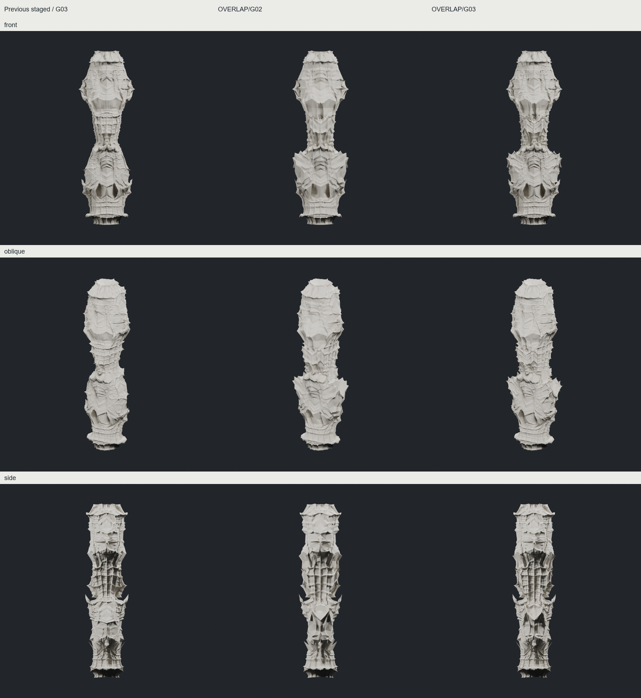

**이번 실험의 진전은 마디 사이의 방향성 있는 겹접힘이다. 추천은 OVERLAP G3, 더 명료한 비교안은 G2다.**

기존 ANCESTRY_STAGED G1에서 두 방향을 비교하고 OVERLAP만 G3까지 진행했다. 이후 같은 OVERLAP G2에서 기존 subdivision의 기하 응답 설정 두 가지를 추가 비교했다. 총 5개의 새 실제 메시 단계이며, 원본·기존 리드·실패안은 보존했다.

| 시험안 | 실제로 얻은 것 / 잃은 것 | 판단 |
|---|---|---|
| CORRIDOR G2 | 기존 골의 벽과 어깨 주변만 성장시켜 균일 격자를 줄였다. 대신 넓은 판면이 노출되고 새 중간 규모 사건은 약하다. | 선택 제어는 유효하나 디자인 발전은 제한적. G2에서 중단 |
| OVERLAP G2 | 높이 범위가 겹치는 좁은 방향의 되접힘 두 개를 먼저 넣었다. 하부 어깨의 비스듬한 겹침, 상부에서 허리로 내려오는 골과 결속이 강화됐다. | 유망. 대담하고 명료한 비교안으로 보존 |
| **OVERLAP G3** | 새 큰 접힘 없이 한 번 더 성장시켜도 G2의 겹침과 측면 깊은 골이 남았다. 넓은 어깨면 주변이 작은 접힌 선으로 분절된다. 허리·끝의 잔격자는 늘었다. | **이번 리드. 국소적인 meso 발전이며 새로운 전체 구성은 아님** |
| FACE_RESPONSE / SIGNED_RESPONSE G3 | 실제 면·모서리 굴곡의 부호에 반응하는 기존 설정. 골은 남지만 정면의 중첩 선이 약해지고 넓고 완만한 면이 늘었다. | 리드 개선으로 선택하지 않음. 추가 세대 중단 |

지역 성장안과 첫 분기는 [G2 비교](images/early_comparison.png), 후속 설정은 [응답 규칙 비교](images/response_comparison.png), 세대 변화는 [OVERLAP progression](images/OVERLAP_progression.png)에 있다. 이미지에는 저장된 실제 삼각형 메시만 표시한다. 카메라·재질·조명·flat normals는 동일하며 smoothing modifier나 텍스처는 없다.

**무엇이 유효했나.** 이전 허리 커프는 반사 후 거의 전 둘레를 함께 팽창시켰다. 이번에는 각도 지지는 좁게, 높이 지지는 겹치게 두고 기존 radial/axial PCHIP 되접힘을 subdivision **전에** 적용했다. 후속 법선·stencil·형상장 연산이 바뀐 입체를 재료로 삼는다. 접힘의 위치를 옮기는 데 그치지 않고 실제 어깨와 골의 기하가 달라졌다. 다만 이는 명시적으로 설계한 기하 변형이며 프랙탈에서 자연 발생한 접힘이나 물리적 origami solver가 아니다.

**무엇이 안 됐나.** 격자만 억제하면 초기의 큰 면이 드러나며, 국소 굴곡을 일괄 증폭해도 깊은 겹접힘이 자동으로 강화되지는 않았다. 두 큰 몸체와 허리라는 기본 구성, 넓은 상부 면, 평행 격자는 아직 남는다. 실제 torsion이나 명시적인 crease-angle memory를 확보했다고 주장하지 않는다. G2→G3 한 번의 시각적 유지가 무제한 반복 보존을 보장하지도 않는다.

실제 성장 횟수는 접힌 G0에서 **3 cycle**이다. G1은 기존 Task36+field, G2는 authored return 2개+Task36+field, G3는 새 return 없이 Task36+field다. 내부 escape 판정 횟수 4→8→18은 이 성장 세대 수와 다르다. 기존 Task36의 V/E/F 계보와 weighted stencil을 재사용했고 표준 CC averaging gain은 0이다. 별도 기하 smoothing은 없지만 stencil의 좌표 조합은 있다.

| 보존안 | 실제 정점 / 삼각형 | 연결·폐합·winding | X 반사 최대 오차 | 자기교차 |
|---|---:|---|---:|---|
| OVERLAP G2 | 12,802 / 25,600 | 1개·통과·통과 | 3.62e-15 | 확인됨 |
| OVERLAP G3 | 51,202 / 102,400 | 1개·통과·통과 | 3.69e-15 | 확인됨 |

반사 정점 대응과 실제 삼각형 집합 일치를 확인했고 Y 반사도 유지된다. 최소 삼각형 면적 기준 `1e-12`는 그대로다. CGAL 교차 결과는 존재 증거이며 전체 교차 개수 비교가 아니다. CORRIDOR와 두 RESPONSE는 빠른 연결·폐합·대칭·면적 확인만 했고 자기교차는 미검증이다. 두께·구조·제작성은 전 후보 미검증이며 교차를 수리하지 않았다.

[IAAC 원문](https://www.iaacblog.com/programs/mesh-subdivision/)의 형상장·subdivision·추가 attractor 구분을 참고했다. 정확한 원본 실행 코드와 최종 컬럼별 조합은 아직 확보하지 못했으며 이번 규칙·계수는 CHESHIRE의 재사용과 시험이다. [출처와 기술 경계](SOURCE_NOTES.md), [핵심 검사](technical/core_validation.json)에 상세를 분리했다.

실제 PLY·float64 NPZ·다음 세대 control·Blender·원본 크기 렌더는 `E:/CHESHIRE_DATA/directional_growth_20261012`에 있다. [INDEX.json](INDEX.json)에 정확한 경로를 기록했다. 코드는 `experiments/directional_growth_20261012`, 브랜치는 `experiment/directional-growth-20261012`다. GitHub 업로드는 하지 않았다.

다음에 발전시킬 가치는 ① OVERLAP의 좁은 방향·넓은 높이 지지 관계를 유지하면서 상부의 넓은 면을 독립적으로 다루는 것, ② 그 연산이 안정된 뒤 초기 마디 간격·비례·침범 정도가 다른 입력을 비교하는 것이다. 같은 G3를 그대로 G4로 올리는 것은 우선하지 않는다.
