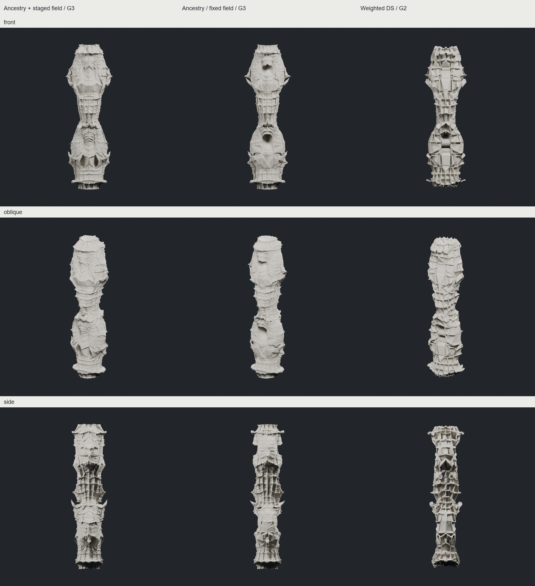

**판단: 부분 채택. 현재 리드는 ANCESTRY_STAGED G3, 비교 리드는 ANCESTRY_LOOP G3다.**

큰 골을 유지하면서 중간 규모의 턱과 중첩 접힘을 발전시키는 조합을 얻었다. 모든 면에 작은 요철을 추가하던 FULL_LOOP보다 형태 위계가 나아졌다. 다만 두 큰 몸체와 허리라는 기본 구성은 거의 그대로이며, 규칙적인 띠·격자와 넓은 면도 남는다. IAAC 수준의 재현 완료나 반복할수록 반드시 아름다워지는 알고리즘으로 평가하지 않는다.

| 보존안 | 얻은 것 | 잃은 것 / 한계 |
|---|---|---|
| **ANCESTRY_STAGED G3 — 추천** | 길게 이어지는 정면 중첩 접힘, 하부의 긴 쌍 골, 측면 깊이. 잔거칠기의 지배가 줄어듦 | 기존의 작은 검은 입구가 약해짐. 허리 격자와 두 몸체 구성은 유지 |
| **ANCESTRY_LOOP G3 — 비교 리드** | 더 강한 가로 접힌 선과 깊은 입구. G2의 큰 골 사이에 G3의 작은 선이 공존 | 일부 띠·격자 반복. 큰 실루엣의 추가 발전은 약함. 차분한 G2도 보존 |
| **DUAL_FIELD_LOOP G2 — 독립 비교안** | 두꺼운 셀 벽과 앞·옆이 일관된 기하학적 조직 | 곡선 접힘이 갑옷 같은 다각 패널로 바뀜. 큰 평면의 위험이 남고 G3는 crust가 과함 |

사용한 핵심 조합은 기존 Task36의 세대 계보를 이용하는 가중 정점 배치와, 매 세대 재평가하는 finite Mandelbulb 계열 형상장이다. 기존 V/E/F 관계를 다음 면의 배치에 사용하며, **명시적인 crease 태그 보호는 구현하지 않았다.** 표준 CC 평균화 성분의 gain은 0이지만, 가중 stencil 자체의 좌표 조합은 사용한다. 별도 메시 smoothing은 없다. Task36 단계의 기존 말단 평면 제약은 남고, 그 뒤의 형상장 이동은 해당 정점을 다시 움직일 수 있다.

STAGED는 실제 성장 3회 동안 내부 escape 판정을 **4→8→18회**로 바꾼다. 고정 18회와 같은 최종 판정에서도 경로 차이가 남았다. 낮은 판정 횟수는 내부 영역과 외부 목표면 자체를 바꾸므로, 동일한 형상장을 단순히 저주파로 거르는 기술은 아니다. 이 설정은 기존 CHESHIRE 가설의 재사용이며 IAAC 공개 공식이라고 주장하지 않는다.

주요 세대 변화는 [STAGED progression](images/ANCESTRY_STAGED_progression.png), [고정 field progression](images/ANCESTRY_LOOP_progression.png), [DS progression](images/DUAL_FIELD_LOOP_progression.png)에 보존했다. G2→G3에서 큰 골이 전부 메워지거나 전체가 평평해지는 현상은 이 두 리드의 실제 3뷰에서 보이지 않았다. 그러나 이는 해당 세대의 시각적 판단이며, 무제한 반복의 보존 보장이 아니다.

**중단·실패 기록도 보존했다.** 공통 법선 이동 MASS_CURVE는 부푼 몸체가 되어 G1에서, signed radial은 톱니·가시가 지배해 G2에서 중단했다. 동일 표면의 삼각/사각 분할 비교는 큰 관계의 차이가 작아 G2에서 멈췄다. FULL_LOOP G3와 DS G3는 작은 셀·거칠기 누적의 한계 기록이다. ANCESTRY_RETURN G3는 기존 PCHIP 되접힘을 허리에 한 번 명시적으로 추가했지만, 끼워 넣은 커프처럼 읽히고 측면의 긴 골을 가려 리드로 선택하지 않았다. 프랙탈에서 자발적으로 발생한 접힘이 아니다. [되접힘 실패 비교](images/authored_return_comparison.png)

**핵심 검증 — 실제 렌더와 동일한 float64 메시.** 최소 삼각형 면적 기준은 기존 `1e-12`를 유지했다. 아래 자기교차 결과는 CGAL의 최초 교차 증거이며 전체 교차 수가 아니다.

| 후보 | 실제 정점 / 삼각형 | 연결체·폐합·winding | 좌우 반사 최대 오차 | 자기교차 |
|---|---:|---|---:|---|
| ANCESTRY_STAGED G3 | 51,202 / 102,400 | 1개·통과·통과 | 3.64e-15 | 확인됨 |
| ANCESTRY_LOOP G3 | 51,202 / 102,400 | 1개·통과·통과 | 3.75e-15 | 확인됨 |
| DUAL_FIELD_LOOP G2 | 12,802 / 25,600 | 1개·통과·통과 | 8.55e-15 | 확인됨 |

앞뒤 반사도 이 세 후보에서 확인했다. 자기교차 수리는 하지 않았다. 두께·구조·제작성은 미검증이며 물리적 origami solver가 아니다. 기술적 실행 성공과 조형적 부분 개선을 구분한다. 다른 중간 후보의 미검증 상태는 개별 generation 기록에 남겼다.

IAAC 원문은 Mandelbrot 파생 형상, 서로 다른 subdivision, 추가 attractor curve 실험을 구분한다. 공개 도식의 nearest-outside와 signed radial 과정도 별도 경로로 시험했다. 원본 실행 코드·정확한 수식·계수·최종 컬럼별 조합은 아직 확보하지 못했다. 원문에 triangular/frame-and-void/quad 실험이 있지만, 이번 triangle 구현이나 DS가 원본과 같다는 근거는 없다. [IAAC 원문](https://www.iaacblog.com/programs/mesh-subdivision/), [공개 Code 도식](https://www.iaacblog.com/wp-content/uploads/2020/12/group-4_python-presentation1.png). 상세 출처 구분은 [SOURCE_NOTES.md](SOURCE_NOTES.md)에 있다.

코드는 `experiments/fold_band_growth_20261011`, 대용량 실제 PLY·NPZ·Blender·전체 렌더는 `E:/CHESHIRE_DATA/fold_band_growth_20261011`에 보존했다. [INDEX.json](INDEX.json)에 후보·세대별 실제 경로, [핵심 검사](technical/core_validation.json)에 검증 결과가 있다. 원본 연산과 기존 후보를 수정하거나 삭제하지 않았다. SPAN_SPARSE는 같은 초기 형상의 표본 수 비교이며, 새 입력 디자인의 다양화는 아직 하지 않았다.

다음에는 ① STAGED와 고정 field 리드를 기준으로 어깨·허리·골의 변형 강도를 구분해 규칙적인 띠를 줄이는 디자인 비교, ② 그 조합이 안정된 뒤 초기 비례·마디·겹침이 다른 입력 비교가 유효하다. 같은 설정으로 세대 수만 늘리는 방향은 권하지 않는다.
