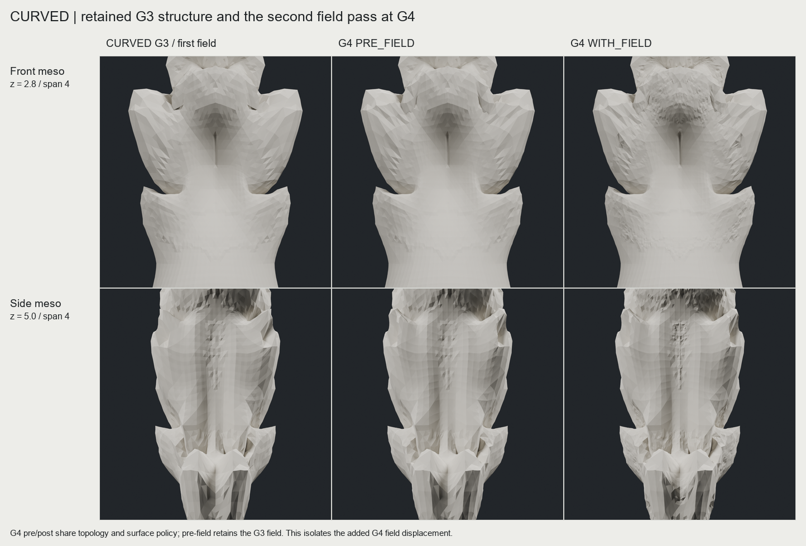
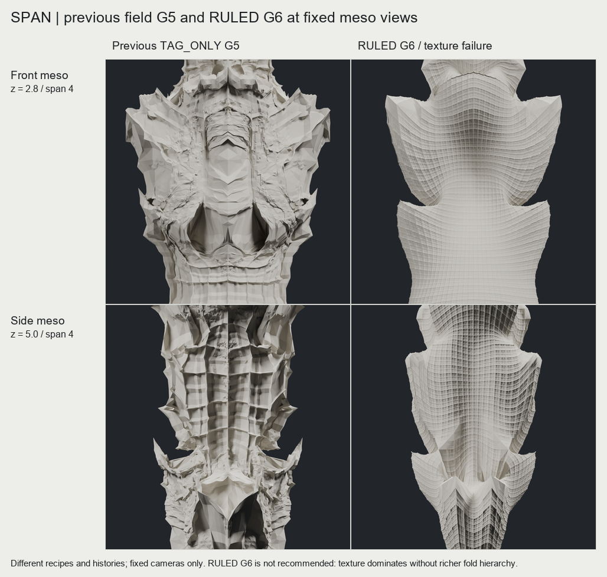

# CHESHIRE - 근접 접힘 위계 / G6 대조 결과

**결론: 이번 RULED G5-G6는 조형적으로 실패한 대조안이다.** 거친 파편을 규칙적인 격자로 바꾸었지만, 큰 접힘에서 작은 골·공동·분기가 발달하는 대신 같은 표면 패턴만 치밀해졌다. 리드 후보로 채택하지 않으며 이 레시피의 G7은 진행하지 않는다. 기존 유망 후보와 모든 실패 결과는 보존한다.

| 시험 | 실제로 얻은 것 | 남은 문제 / 결정 |
|---|---|---|
| FLOW G3-G5, 두 입력 | 대각 어깨와 큰 되접힘의 연결 일부 개선 | G5에서 grain/선반 격자가 큰 골과 경쟁. 초기 단계 기록 보존 |
| LATE G1-G5 | 초기 활성화를 늦춰 긴 측면 골을 유지 | 큰 초기 패싯 위에 잔패싯이 쌓임. 그대로 반복하지 않음 |
| CURVED G1-G4 | 기존 CC 성분으로 초기 패싯을 완화하고 큰 골 유지 | G4 field가 중간 규모 접힘보다 잔패싯을 추가. 이 recurrence 중단 |
| RULED G3-G6 | field 없이 동일 subdivision 규칙을 반복, 실제 기하 격자와 깊은 골 유지 | **표면 텍스처 우세. 장식 위계 확보 실패. G6는 세밀화 한계 대조로만 보존** |

CURVED G4의 저장된 field 전후 메시를 같은 카메라로 비교했다. 이 세대의 field는 큰 골을 거의 유지하면서 작은 패싯을 추가한다. 따라서 현재 필드를 더 강하게 쓰는 것에는 근거가 없다. 다만 이것이 모든 Mandelbulb 방식의 실패를 의미하지는 않는다. RULED는 gain과 return 일정도 다른 디자인 비교이며, 순수한 field 제거 실험이라고 부르지 않는다.

[G6 정면·사선·측면](images/ruled_g6_views.png) / [G3-G6 근접 변화](images/ruled_meso_progression_g06.png). 모든 이미지는 실제 메시, 동일 카메라, 단일 재질 렌더다. 셰이딩으로 디테일을 추가하지 않았다.

RULED G6는 **6회 subdivision, fractal field 적용 0회**다. G2의 원래 macro return 두 개를 물려받고 이후 새 authored return을 추가하지 않았다. 물리적 종이접기를 6번 했다는 뜻은 아니다. 실제 메시: `E:/CHESHIRE_DATA/fold_coherence_20261012/RULED/SPAN/G06/column.ply` (3,276,802 정점 / 6,553,600 삼각형).

핵심 빠른 검사: X/Y 반사 오차 최대 `3.83e-15`, 반사 triangle set 일치, 연결체 1개, 폐합·일관된 winding 통과. 정확한 보호 core의 placement는 0이다. 이는 주변 접힘 각도 전체를 보호했다는 뜻이 아니다. **새 LATE/CURVED/RULED의 자기교차는 미검증**이며 사용자 지시에 따라 탐색을 막는 조건으로 쓰지 않았다. 두께·강도·FDM 출력 가능성도 미검증이다. 현재 G6는 출력용 완성 원형이 아니다.

제공된 mirror 논문에서 유용한 점은 마지막 곡면화 전에 cut/mirror/join으로 연결 관계가 만들어진다는 점이다. 이 방법을 구현한 것은 아니다. Tissue 역시 이번 결과에 적용하지 않았다. 새 기술을 덧붙였다고 문제 해결로 간주하지 않는다.

G4-G5 표면 전체에 Oxman/Tissue 로직을 투영하는 방식은 권하지 않는다. 논문의 cut/mirror/join은 표면 투영이 아니며 저해상도 control 구조에서 먼저 비교할 가치가 있다. Tissue를 작은 면마다 배치하면 다시 균일 패턴이 될 수 있다. 향후 사용하더라도 부모 접힘과의 관계가 먼저 생긴 선택 영역에 제한하는 편이 타당하다는 판단이며, 아직 구현·검증한 해결책은 아니다.

다음 진행은 두 가지로 제한할 가치가 있다.

1. CURVED G2 또는 이전 큰 접힘 체크포인트에서, **소수의 부모 접힘이 새 골·되접힘·공동을 만드는 중간 규모 변형**을 먼저 시험한다. 전체 표면의 셀 반복은 보류한다. 전체·측면에서 질량 관계가 달라지지 않으면 미세화하지 않는다.
2. fractal field를 다시 쓸 경우 미세 정점별 거칠기보다 **큰 변형의 영역·방향을 제어하는 역할**을 비교한다. 유효성은 아직 검증되지 않았다.

최신 대조는 SPAN 한 입력에서만 시험했다. 앞선 FLOW의 두 입력 결과가 이 새 레시피의 범용성을 증명하지는 않는다. [실제 자산 목록](DEVELOPMENT_INDEX.json), [구현 상세](DEVELOPMENT_NOTES.md), [논문 참고](MIRROR_NOTE.md)는 별도로 보존한다.
