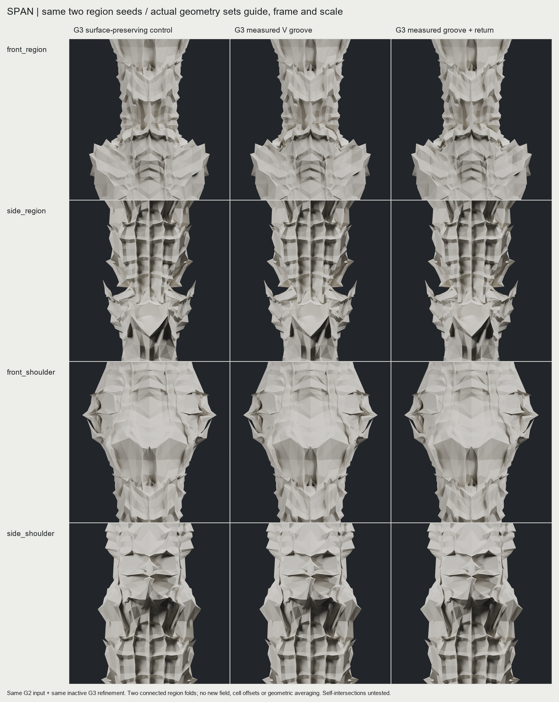
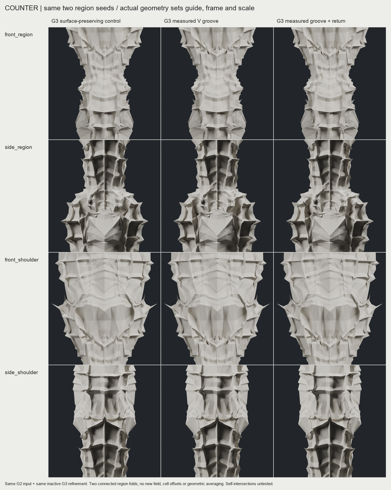

# CHESHIRE — 실제 형상에서 다음 골을 읽는 두 입력 비교

**두 입력에 같은 규칙을 적용해 새 중간 골을 만들었다. 전체 접힘 위계는 여전히 PARTIAL이다.** 다음 출발점은 `longitudinal_region / GROOVE`로 선택했다. 원래의 깊은 접힘을 바탕으로 긴 어깨 구간을 측정하고, 그 구간 안에 새 골을 만든다. 단순히 subdivision 횟수나 표면 요철을 늘리는 경로에서 한 단계 옮겼다.

이번 결정은 사용자가 정한 우선순위를 따른다. 한 기둥의 표면 완성보다 **두 입력에서 같은 규칙으로 새 접힘이 읽히는 성과**, 매끈함보다 **골·어깨·작은 접힘의 크기와 방향 관계**를 먼저 확보한다. 이전 대화에서는 프로젝트에 관한 결정만 참고했다. 기존 후보와 체크포인트는 수정하지 않았다.

## 실제 비교

각 그림의 왼쪽은 원래 표면을 유지하며 G3로 세분한 대조군, 가운데는 측정한 세로 골, 오른쪽은 골과 어깨 회전을 함께 적용한 안이다. 동일한 카메라·재질로 실제 저장 삼각형을 렌더링했다. 그림을 클릭하면 원본 크기로 볼 수 있다.

전체 형상에서는 차이가 작다. 큰 실루엣을 바꾸는 실험이 아니라 기존 벽 안에 중간 골을 만드는 실험이다. 근접에서도 원래의 거친 면과 반복적인 단이 상당히 남아 있다. 이를 레퍼런스에 가까운 완성형으로 판정하지 않는다. [SPAN 전체](images/span_whole.png) · [COUNTER 전체](images/counter_whole.png)

## 무엇이 막고 있었나

기존 후속 접힘은 공통 재료 좌표와 미리 정한 사건으로 위치·변위를 정했다. 입력 형상이 달라도 같은 좌표에 같은 변위가 적용될 수 있었다. 이것은 규칙의 재사용은 되지만, **형상을 읽어 다음 접힘을 결정한다는 목표**에는 부족했다.

보호점의 위치를 남기는 것과 골의 폭·깊이·각도를 남기는 것도 다르다. 반대로 모든 옛 점을 고정하면 같은 벽을 다시 접기 어렵다. 이번에는 원본을 별도로 보존하고, 새 변형 구간 안에서는 옛 점도 움직일 수 있게 했다. 구간 끝과 경계의 변위는 0이다. 기존 골의 깊이·각도 전체가 정확히 보존된다고 주장하지 않는다.

또 하나의 병목은 작은 패싯에서 읽은 방향이었다. 세로 가이드를 연결해도 인접 방향이 크게 뒤집혔다. 구간 전체에서 방향을 추정하면 이 변화가 줄었다. 이 과정에서 원본 메시 좌표를 평활화하지는 않았다. 실제 접힘의 방향 변화도 함께 완만하게 만들 수 있으므로, 방향 안정화 자체를 조형 개선의 증명으로 보지는 않는다.

## 검증한 가능성과 선택

세 가지 구성에서 두 입력과 세 모드(CONTROL / GROOVE / RETURN)를 비교했다. 총 18개 G3 상태다. 아래 숫자는 각 후보의 **14개 유한 재료 좌표 절단 중 새 골이 검출된 절단 수**다. 전체 형상의 품질 점수나 연속성 인증이 아니다.

| 구성 | SPAN 골 / 골+회전 | COUNTER 골 / 골+회전 | 판단 |
|---|---:|---:|---|
| 가로 가이드, 국소 방향 | 5 / 8 | 5 / 9 | 새 주머니가 생기지만 독립된 커프처럼 끊겨 보임. 비교안으로 보존 |
| 세로 가이드, 국소 방향 | 8 / 11 | 9 / 12 | 긴 벽 안으로 이동했으나 패싯의 큰 방향 변화도 물려받음 |
| **세로 가이드, 구간 방향** | **10 / 9** | **11 / 11** | **GROOVE를 다음 출발점으로 선택**. 회전 추가의 이점은 명료하지 않음 |

회전안의 수치가 높았던 구성도 있다. 다만 더 많은 절단에서 골이 검출되는 것만으로 위계가 좋아졌다고 선택하지 않았다. 구간 방향을 쓴 단순 골은 두 입력에서 일관된 결과를 냈고 추가 회전보다 제어하기 쉽다. [가로 SPAN 비교](images/transverse_span_detail.png) · [가로 COUNTER 비교](images/transverse_counter_detail.png)

## 실제 구현과 검증 범위

공통의 두 부모 탐색 영역만 이어받고, 새 골의 위치·방향·물리적 크기는 실제 G2 삼각형에서 측정했다. 어깨의 호 길이 55% 지점에 가이드를 놓고, 측정한 어깨 길이의 28%를 깊이 계수로 쓴다. 두 입력의 계수는 같다. 아직 부모 영역을 완전히 자동으로 찾는 알고리즘은 아니다.

선택안의 최대 제어점 변위는 SPAN `0.14891`, COUNTER `0.20898` 프로젝트 단위다. 입력이 달라지면 측정값과 결과도 달라진다. 새 G3는 각각 실제 정점 51,202개, 삼각형 102,400개다. 새 fractal field 적용은 없고, 원본 G2의 기존 2회 적용 이력을 유지한다.

- 새 실험 테스트 **9개 통과**: 실제 삼각형 보간, 범위 밖 샘플 거부, 크기 변화, 형상 반응, 영 변형, 부모 골 부재, 구간 방향 검사.
- 저장된 **18개 변형 재생 오차 0**. 각 구성 안에서 두 입력의 계수가 같은지 확인했다.
- 저장소에 포함한 두 G2 입력으로 선택안을 새 폴더에서 다시 생성했다. 제어 메시·실제 삼각형·변위·두 가이드 배열이 모두 동일했다.
- 18개 상태 모두 유한 좌표, 닫힘, winding, 단일 연결체, 최소 삼각형 면적, X/Y 반사 검사를 통과했다.

원본에는 알려진 자기교차가 있다. 이번 단계에서는 자기교차·두께·강도·FDM 제작 가능성을 검증하지 않았다. 위 검사는 제작 가능 판정이 아니다. 기존 전체 테스트 묶음은 다시 실행하지 않았으며, 기존 엔진 코드는 변경하지 않았다. [측정 요약](SUMMARY.json) · [저장 변형 재생](technical/saved_operations.json) · [파일 해시](MANIFEST.json)

## 레퍼런스에서 가져온 기준

IAAC의 공개 기록은 subdivision과 Mandelbrot 기반 제어, attractor 곡선, 서로 다른 초기 형상·깊이의 변형을 설명한다. 공개 자료만으로 원 프로젝트의 실행 코드를 정확히 복원했다고 볼 수는 없다. 이번에는 다른 입력에도 적용되는 규칙이라는 기준을 참고했다. [IAAC — Mesh Subdivision](https://www.iaacblog.com/programs/mesh-subdivision/)

Hansmeyer는 전체 비례부터 국소 형성과 미세 구조까지 하나의 과정이 작동하고, 입력의 구분된 부분에 서로 다른 매개변수가 적용되는 과정을 설명한다. 이번 연구에서는 이를 **큰 골이 작은 접힘의 위치·방향·크기를 결정해야 한다는 설계 기준**으로 해석했다. 이는 참고 자료에 대한 우리의 해석이며, 그의 알고리즘을 재현했다는 뜻은 아니다. [Michael Hansmeyer — Subdivided Columns](https://michael-hansmeyer.com/subdivided-columns.html)

## 아직 해결해야 할 문제

1. **새 골이 다음 접힘의 부모가 되는 연결.** 지금은 원래 G2에서 읽은 한 번의 G3 조작이다. 생성된 골의 벽·어깨를 다시 측정해 더 작은 접힘을 넣는 반복은 구현하지 않았다. 이것이 다음 핵심 실험이다.
2. **골 사이의 만남과 분기.** 두 가이드는 따로 측정한다. 연결, 합류, 갈라짐을 제어하지 않으므로 전체 위계는 여전히 부족하다.
3. **보존할 형상 관계의 측정.** 점 고정 대신 부모 골의 폭·깊이·각도 중 무엇이 얼마나 바뀌었는지 측정해야 한다. 현재는 새 골 발생과 기본 무결성까지만 확인했다.
4. **입력 범위 확장.** 두 사례는 서로 다른 실제 형상이지만 같은 위상·재료 좌표·부모 사건을 공유한다. 임의 메시와 게이트에 대한 일반화는 입증하지 않았다.

현재 주어진 우선순위 안에서 추가 가치판단을 요청할 충돌은 없다. 다음 비교에서도 위 네 문제를 분리해 확인하고, 세분화 숫자 증가만으로 진전이라 부르지 않는다. [구현·재실행 경로](TECHNICAL_NOTES.md)
