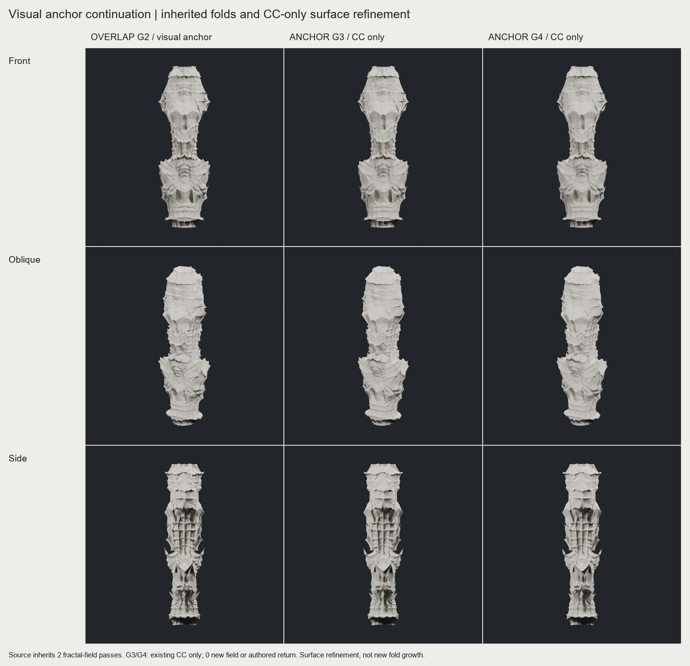
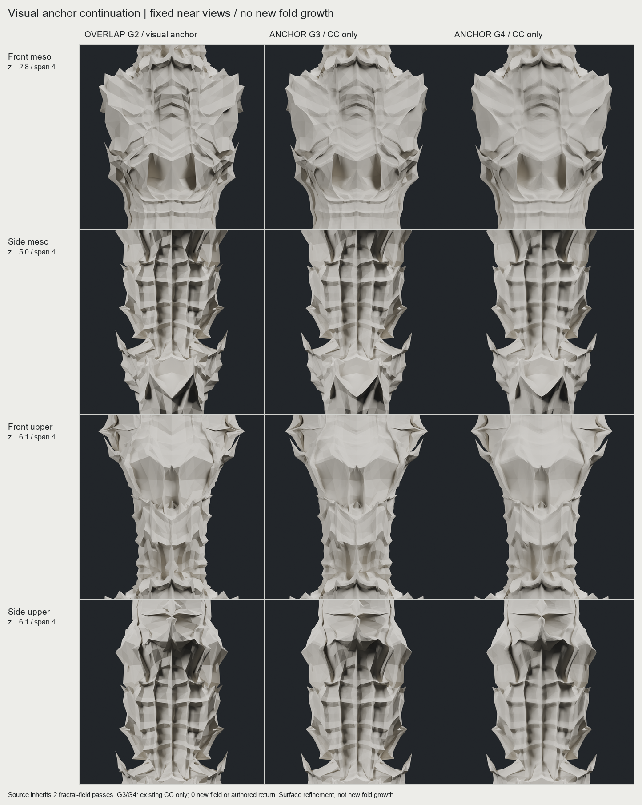

# CHESHIRE — 원래 접힘으로 돌아온 근접 형상 비교

**결론: OVERLAP G2의 깊은 골과 겹친 어깨를 유지한 ANCHOR G4를 면 정리 비교안으로 보존한다. 새 접힘의 성장 문제는 아직 해결하지 못했다.** 원본 G2의 날카로운 형태도 함께 유지한다. 이번 단계는 기둥 연구이며 게이트에는 적용하지 않았다.

## 실제 결과

앞서 확인한 원래 기둥 이미지의 정확한 출처는 **OVERLAP G2**다. 이 체크포인트에서 직접 G3와 G4를 생성했다. 아래 비교는 같은 카메라·재질의 실제 메시 렌더다. 확대 뷰에도 셰이더 디테일이나 렌더용 subdivision은 없다.

| 비교안 | 얻은 것 | 잃은 것 / 결정 |
|---|---|---|
| 원본 OVERLAP G2 | 깊은 쌍골, 사선으로 겹친 어깨, 날카로운 중앙 결속 | 근접에서 큰 패싯과 짧은 분기가 거칠다. 원형 기준으로 보존 |
| ANCHOR G3 → G4 | 골 양옆 벽과 어깨의 면 연결이 부드러워진다. 정면과 측면의 깊은 함몰, 전체 비례는 시각적으로 유지 | 날 끝과 중앙 V띠의 예리함 일부 감소. 측면의 반복 선반과 큰 패싯은 남는다. **부분 채택: 면 정리 비교안** |
| CURVED G2 → CONTROL / RETURN G3 | CC만 적용한 대조군과 넓은 되접힘 두 개를 추가한 안을 같은 입력에서 비교 | RETURN은 옆의 작은 포켓과 새 커프처럼 읽혀, 연속적인 접힘 위계의 개선으로 선택하지 않음. G3에서 중단 |

[CONTROL / RETURN 전체](images/g3_whole.png) · [동일 위치 확대](images/g3_detail.png). 이 비교의 CURVED G2는 OVERLAP G2와 **다른 입력**이다. 두 비교를 한 변수 실험으로 합치지 않는다.

## 구현한 기술과 현재 한계

| 기술 | 실제 확보한 범위 | 남은 한계 |
|---|---|---|
| 방향·높이를 분리한 되접힘 | 연속 PCHIP radial/axial 변형, 지지 범위의 중첩, X/Y 거울상 대응. 원본 G2에 두 사건이 들어 있다 | 기하 변형이며 물리 origami solver가 아니다. 이번 추가 RETURN은 조형적으로 채택하지 않음 |
| 기존 Task36 subdivision 성분 제어 | averaging / stencil / normal을 분리해 조합. 이번 ANCHOR는 averaging 성분만 사용 | CC의 곡면화는 면질을 개선하지만 새 장식 위계를 자동 생성하지 않음 |
| legacy feature 태그 | authored fold 중심의 이동을 억제하고 세분화 후에도 태그를 전달 | 보호점의 위치 보존이지 전체 골벽·접힘 각도 보존이 아님 |
| Mandelbulb 계열 필드와 subdivision 결합 | 원본 G2는 기존의 두 field 적용을 포함. 격자의 nearest-outside 목표를 이용한 변형 경로 보유 | 현재 매핑을 후속 세대에 강하게 적용하면 잔패싯이 먼저 증가한 사례가 있음. **ANCHOR G3/G4에서는 새 field를 적용하지 않음** |

이전 [RULED G6](../fold_coherence_20261012/NEAR_VIEW_REPORT.md)는 정돈된 격자를 얻었지만 표면 텍스처가 우세해 실패로 기록했다. 세대 수 증가만으로 해결되지 않았다. [cut-reflect 시험](../structural_fold_20261012/STOPPED.md)의 Y자 분기는 원래의 근접 디테일 문제를 해결하지 못한 별도 실패안이며 중단했다. 기존 후보·코드는 보존했다.

## 핵심 검증

ANCHOR G4는 **204,802 정점 / 409,600 삼각형**, 연결체 1개, 폐합 및 winding 검사 통과다. X/Y 반사 정점 오차 최대 **3.81e-15**, 반사 삼각형 집합도 일치한다. 최소 삼각형 면적은 `3.94e-7`로 기존 기준 `1e-12`를 통과한다. CONTROL / RETURN G3와 ANCHOR G3도 같은 빠른 검사를 통과했다.

**원본 OVERLAP G2의 자기교차는 이전 검사에서 확인됐다.** 이번 후속 메시들의 자기교차는 미검증이며 교차가 해결됐다고 주장하지 않는다. 두께·강도·실물 크기·FDM 출력 가능성도 미검증이다. 폐합과 대칭 통과는 제작 가능성 인증이 아니다. [실제 검사 기록](technical/generation_records.json)

## 다음 개선 방향 — 아직 미구현

1. **작은 셀보다 골·어깨의 연결 구간을 발달 단위로 삼기.** 원본 G2 또는 G4의 큰 접힘 사이에 소수의 중간 규모 사건을 만들고, 면 정리는 그 뒤에 적용한다. 이번처럼 새 커프가 독립된 단으로 읽히면 채택하지 않는다.
2. **필드를 정점별 잔요철보다 영역·방향의 제어에 쓰는 비교.** 현재의 nearest-outside 변위를 전면 반복하는 대신, 연결된 구간의 어느 쪽이 수렴·발산할지를 제어할 수 있는지 확인한다. 효과를 확인한 뒤 같은 규칙을 다른 초기 입력으로 옮긴다. 임의 메시나 게이트로의 일반화는 아직 입증하지 않았다.

[기술 상세와 실행 경로](TECHNICAL_NOTES.md) · [선별 자산과 해시](MANIFEST.json) · [G4 실제 메시 배열](review_assets/ANCHOR_G04/geometry.npz). 대용량 PLY·전체 체크포인트·개별 렌더는 `E:/CHESHIRE_DATA/fold_return_20261012`에 보존했다.
