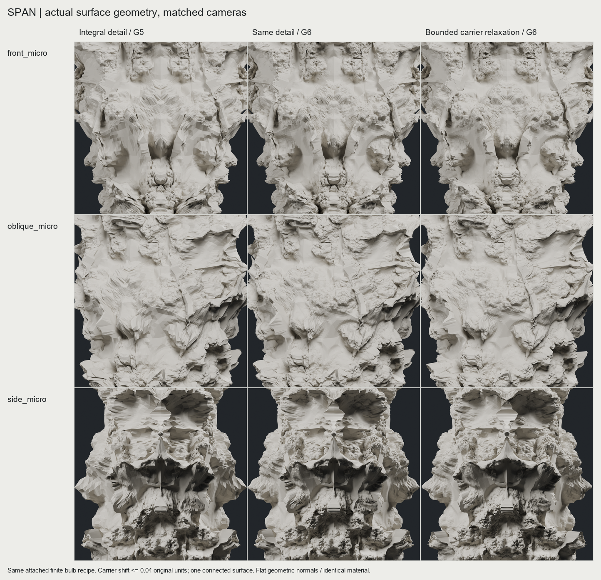
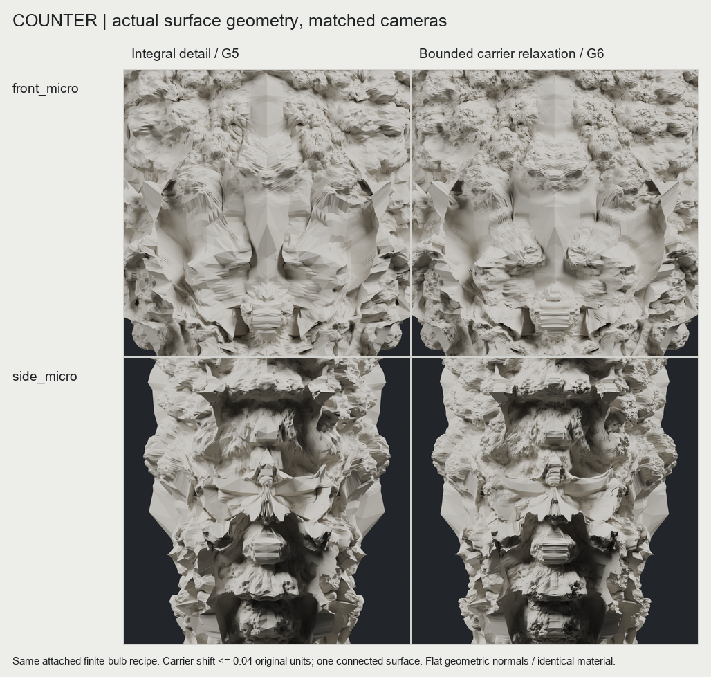
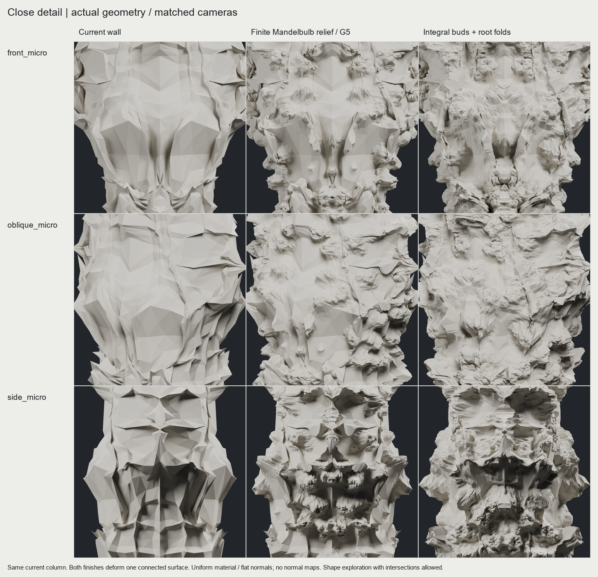
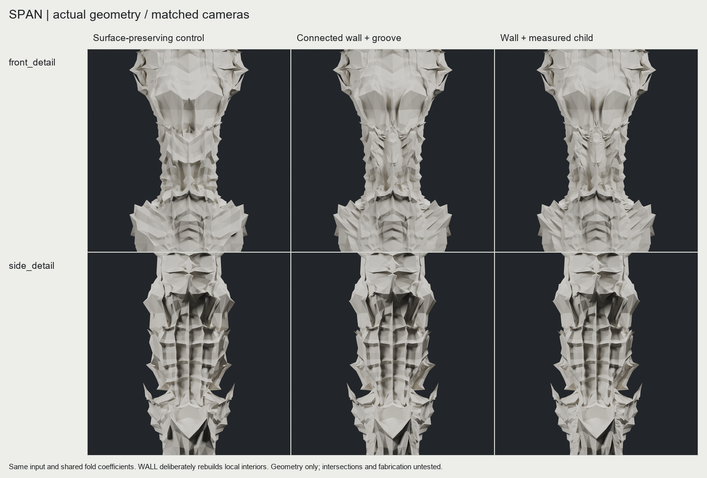
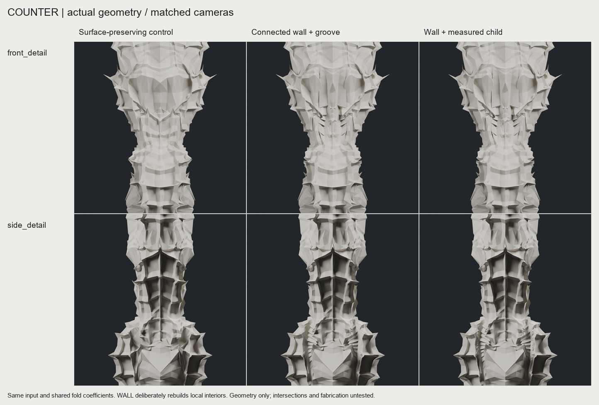
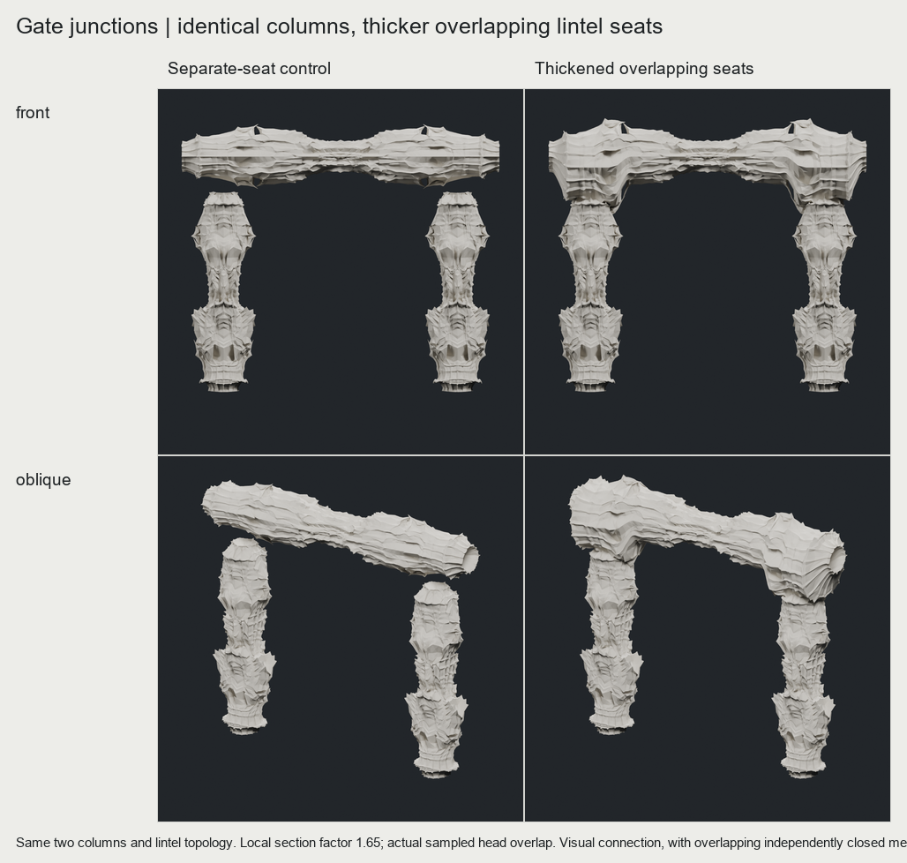

# CHESHIRE 본체와 이어진 근접 디테일과 고정 기둥 게이트

**기존 기둥의 실제 표면을 변형해, 본체에서 이어지는 두 크기의 돌출과 뿌리 접힘을 만들었다.** SPAN과 COUNTER에 같은 규칙을 적용했다. 근접 디테일은 긴 골만 있던 단계보다 분명해졌고, 게이트의 상인방도 양쪽 기둥 머리와 겹치도록 두껍게 연결했다. 큰 골에서 작은 분기로 이어지는 장식 위계는 여전히 **PARTIAL**이다.

사용자가 정한 조건은 두 입력에 같은 규칙을 적용하는 것, 큰 골·어깨·작은 접힘의 크기와 방향 관계를 살리는 것, 디테일이 본체에서 떨어지지 않는 것, 정면 대칭을 유지하는 것이다. 교차는 이번 형상 탐색의 중단 조건으로 삼지 않는다. 게이트는 넓은 개구부 B와 기둥 단면을 기준으로 하며 비례 탐색을 반복하지 않는다.

## 남은 각짐의 비교와 선택

왼쪽은 사용자가 승인한 G5 INTEGRATED, 가운데는 같은 디테일을 더 촘촘하게 계산한 G6, 오른쪽은 큰 면의 경계를 제한적으로 완화한 뒤 같은 디테일을 계산한 G6다. **오른쪽 RELAXED_G06를 다음 출발점으로 선택했다.** 해상도 증가만으로는 원래의 큰 평면 경계가 남는다. 실제 큰 면의 제어 좌표를 조금 움직인 안은 중앙 면과 어깨의 각진 경계를 더 누그러뜨리며, 작은 돌기와 뿌리 접힘도 유지한다. [같은 축척의 전체 비교](review/images/span_refinement_whole.png)

실제 WALL G3 제어망에 유한한 Taubin 완화를 적용하고 이동 길이를 원본 좌표 `0.04` 이하로 제한했다. 재료 높이의 아래 10%와 위 10%는 고정했다. 그 뒤 세 번 세분화하고 같은 atlas와 돌기 위치·크기 규칙을 적용한다. 렌더의 법선만 바꾼 결과가 아니다. G6는 입력마다 실제 정점 3,276,802개, 삼각형 6,553,600개다.

완화 후에도 표면은 부분적으로 평면이며 돌기 끝의 각짐이 전부 없어지지는 않았다. 이번 차이는 절제되어 있고 큰 골의 좌표가 원래와 완전히 같다는 주장도 하지 않는다. 디테일을 더하면서 정면 대칭이 무너지지 않는 것을 필수 조건으로 두었다. 두 입력의 실제 native 정점 반사 오차는 각각 `3.82e-15`, `4.24e-15`이며 방향 있는 삼각형 집합도 정확히 대응한다. [선택안의 두 입력 재생](review/finish_g6/compact_finish_g6_replay.json)

## 앞 단계: 본체에서 이어지는 디테일

왼쪽은 기존 WALL, 가운데는 간격이 넓은 BOLD_DETAIL, 오른쪽은 채택한 INTEGRATED다. 모두 저장한 실제 삼각형이며 같은 재질과 카메라를 사용했다. INTEGRATED는 더 넓은 두 크기의 돌기를 놓고 뿌리 주변을 조금 안으로 접어 연결감을 높인다. 표면 부품을 덧붙이지 않아 두 입력 모두 연결 성분이 하나이고, 같은 해상도의 원본과 삼각형 연결이 동일하다. [전체 모습](review/images/finish_whole.png)

돌기의 기본 형상은 유한한 power-8 Mandelbulb 점유 검사의 위쪽 높이 투영이다. 무한 프랙탈의 정확한 경계나 완전한 입체 Mandelbulb를 기둥에 합친 것은 아니다. 큰 돌기와 작은 돌기의 반지름은 원본 좌표에서 `0.30`, `0.14`, 진폭은 `0.22`, `0.07`이며 결합 변위의 상한은 `0.30`이다. 실제 위치 간격 때문에 큰 돌기는 SPAN 90개, COUNTER 98개가 놓였다. 작은 돌기는 각각 두 배다. 모든 변위가 바깥쪽인 것은 아니며 뿌리 접힘에는 안쪽 변위도 있다.

G5는 입력마다 실제 정점 819,202개와 삼각형 1,638,400개다. 저장된 atlas·표면 위치·규칙을 패키지의 WALL 부모에서 다시 실행해 제어망, 연산, 실제 삼각형 배열의 해시가 모두 일치했다. [두 입력의 재생 기록](review/finish/compact_finish_replay.json)

별도 가지 부품을 겹친 시험안은 본체에서 떨어져 보인다는 사용자 판단에 따라 제외했다. 이 실패를 밀도가 높은 성과로 합산하지 않는다. TISSUE는 검토 가능한 대안으로만 남았으며 사용하지 않았다.

## 앞 단계: 긴 면과 작은 자식 접힘

왼쪽은 표면을 유지하는 세분화 대조군, 가운데는 긴 면과 골을 만드는 WALL, 오른쪽은 실제 WALL 형상에서 측정한 작은 자식 접힘을 더한 CHILD다. 같은 카메라와 재질로 저장된 실제 삼각형을 렌더링했다.

두 입력 모두 상부 어깨에 더 길고 경계가 분명한 세로 골이 생긴다. 측면에서는 면의 방향 변화가 더 잘 드러난다. 전체 윤곽은 대부분 유지된다. [SPAN 전체](review/images/span_whole.png) · [COUNTER 전체](review/images/counter_whole.png)

이번에는 골의 깊이만 늘리지 않고, 실제 측정한 두 어깨와 골을 잇는 면을 구간 내부에서 다시 구성했다. 영역 끝과 경계의 변위는 0으로 줄이되, 내부의 옛 제어점도 움직이게 했다. 이 자유도가 긴 면을 만드는 데 필요했다. 원본 체크포인트는 그대로 보존한다.

다만 모든 입력에서 면이 더 매끈해진 것은 아니다. 가이드마다 7개씩 총 14개 원시 절단에서 측정한 벽 직선 근사의 잔차 중앙값은 SPAN에서 `0.003080 → 0.003587`로 증가했고, COUNTER에서 `0.003420 → 0.001175`로 감소했다. SPAN의 가이드 근처 chord relief도 증가하지 않았다. 이 지표들은 변형의 성격을 설명하며, 조형 품질 점수나 전체 곡면의 평활도 인증이 아니다. [원시 측정 요약](review/receipts/wall_summary.json)

## 같은 두 기둥과 새 대칭 상인방

두 기둥은 WALL SPAN G3의 실제 좌표와 삼각형을 그대로 두 번 사용한다. 공통 균일 축척으로 검토용 높이 3m를 정하고 이동만 적용했다. 개구부는 약 2.53m다. 새 상인방은 이전 실제 G2를 길이 방향 짝점과 반사 평균해 대칭 입력으로 만들었다. 그 실제 표면에서 네 탐색 구간을 새로 측정한 뒤 같은 WALL 연산을 적용했다. 완성된 기둥 하나를 눕힌 결과가 아니다.

상인방 입력의 단면은 기둥의 최대 폭·깊이와 같은 약 `0.973 × 0.747m`, 길이는 `4.770m`다. 접힘을 적용한 결과의 깊이는 `0.726m`로 약 2.75% 줄었다. 결과마다 재축척해서 이 차이를 숨기지 않았다. 짝점 평균으로 비대칭 큰 접힘이 약해질 수 있고, 변위의 앞 절반을 반사하는 제약으로 중앙에 접힘이 생길 수 있다. 대칭은 명시적 생성 조건이다.

초기 세 비교안 모두 실제 정점과 방향 있는 삼각형 집합의 정면 좌우 반사가 일치한다. 좌표 오차는 약 `1.37e-15`이며 기둥의 원본 변환 오차는 0이다. [초기 상인방 비교](review/images/fixed_gate_whole.png) · [상인방 재생](review/fixed_gate/verification.json)

채택한 JOINED는 양쪽 기둥 머리 근처의 상인방 단면을 국소적으로 `1.65배` 늘리고 약 `0.163m` 내렸다. 두 기둥은 그대로다. 머리마다 실제 삼각형을 관통하는 3×3 수직 ray를 검사해 9/9곳의 겹침을 확인했고, 중앙 ray의 겹침 길이는 양쪽 약 `0.051m`다. 굵어진 부위는 이전 상인방 전체의 최대 높이보다 약 17.3%, 깊이보다 약 35.7% 크다. 부재 세 개가 겹친 조형적 접속이며 Boolean 합체나 강도 검증은 아니다. [접속 근접 비교](review/images/joined_gate_detail.png) · [전체 조립 재생](review/gate_joined/compact_joined_replay.json)

이 게이트 이미지는 WALL G3 기둥을 쓴 접속 검토다. 위의 새 근접 디테일을 게이트 전체에 이미 적용한 결과로 해석하면 안 된다.

## 실제 부모 형상에서 만든 작은 접힘

CHILD는 WALL G3의 실제 삼각형에서 골을 다시 찾고, 그 바깥 어깨의 물리적 호 길이 35–75%에 작은 접힘을 놓는다. 깊이는 같은 위치의 부모 깊이 40% 이하로 제한했다. 두 입력의 최대 실제 비율은 약 26.5%다. 생성된 골이 다음 단계의 측정 기준이 되는 연결은 구현했다.

| 입력 | 부모 골 검출 | 새 작은 골이 검출된 유한 절단 |
| --- | --- | --- |
| SPAN | 25/25, 23/25; 둘째 구간 내부 2개 보간 | 5/15, 7/15 |
| COUNTER | 25/25, 25/25 | 9/15, 6/15 |

검출하지 못한 끝 구간을 임의로 늘리지 않았다. 표의 새 골 수는 정해진 임계값을 사용한 국소 진단이며, 연속 위계의 증명이 아니다. CHILD와 WALL의 전체 그림 차이는 작다. 따라서 이번 게이트의 기둥에는 더 분명한 변화가 보이는 WALL을 사용한다.

부모 골을 전부 정확히 고정한다는 주장도 하지 않는다. 같은 G4 기준으로 비교하면 SPAN 둘째 부모의 최대 이동이 `0.003547`이며 중앙값은 0이다. 두 가이드 영역이 만나는 부분의 소유 관계를 더 해결해야 한다. 첫 실행의 `generation.json`에는 G3/G4 재료 보간 차이까지 섞인 보존 수치가 있으므로, 보존 판정은 [교정된 두 입력 검증](review/receipts/child_two_input_verification.json)을 따른다. [작은 패키지의 재생 기록](review/compact_child_replay.json)

## 레퍼런스에서 이어받은 기준

IAAC의 공개 프로젝트는 subdivision과 Mandelbrot 기반 제어를 결합하고, 깊이·초기 형상·attractor 변화로 결과군을 만든다. 이번에도 서로 다른 두 실제 입력에 같은 계수를 적용하는 기준을 유지했다. 공개 기록만으로 IAAC의 실행 코드를 복원했다는 뜻은 아니다. [IAAC Mesh Subdivision](https://www.iaacblog.com/programs/mesh-subdivision/)

Hansmeyer는 전체 형상부터 국소 표면과 미세 구조까지 이어지는 과정을 설명한다. 이번에는 이를 큰 골의 실제 어깨가 다음 작은 접힘의 위치·방향·크기를 결정해야 한다는 기준으로 해석했다. 지금의 긴 면과 작은 골만으로 그 레퍼런스의 연속성과 밀도에 도달했다고 보지는 않는다. [Michael Hansmeyer Subdivided Columns](https://michael-hansmeyer.com/subdivided-columns.html)

Digital Grotesque II의 서로 다른 크기로 반복되는 성장·접힘과 복잡한 분기는 근접 판정의 기준이다. 지금의 표면 높이 투영만으로 그 입체 분기와 연속 위계를 구현했다고 보지는 않는다. [Digital Grotesque II](https://michael-hansmeyer.com/digital-grotesque-II) · [Mandelbulb 원형 참고](https://www.skytopia.com/project/fractal/mandelbulb.html)

## 남은 조형 문제

1. 큰 면과 돌기 끝에 다각형의 각짐이 남아 있다. 같은 디테일의 해상도 증가와 실제 큰 면의 경계 완화를 구분해 비교해야 한다.
2. INTEGRATED의 밀도와 몸체 연결감은 좋아졌지만 일부는 두꺼운 층처럼 읽힌다. 큰 골에서 중간 분기를 거쳐 작은 돌기로 이어지는 방향 관계가 필요하다.
3. 두 접힘 영역이 만나는 부분의 소유 관계가 없다. 한 자식이 다른 부모를 움직이는 작은 오차를 포함해 분기·합류 규칙이 필요하다.
4. 게이트의 조형적 접속은 붙였지만, 새 근접 디테일의 전체 게이트 적용과 접속부에서의 연속 흐름은 아직 남아 있다.

자기교차·두께·접합 강도·제작 가능성은 이번 판정 범위에 포함하지 않는다. 기존 원본에도 자기교차가 알려져 있다. 새 실험은 이 조건을 형상 탐색의 중단 조건으로 삼지 않았으며, 닫힌 메시라는 사실은 제작 가능성을 뜻하지 않는다.

구현 경로와 재생 방법은 [기술 기록](TECHNICAL_NOTES.md)에 있다. 기존 엔진과 과거 실험은 변경하지 않았다.
