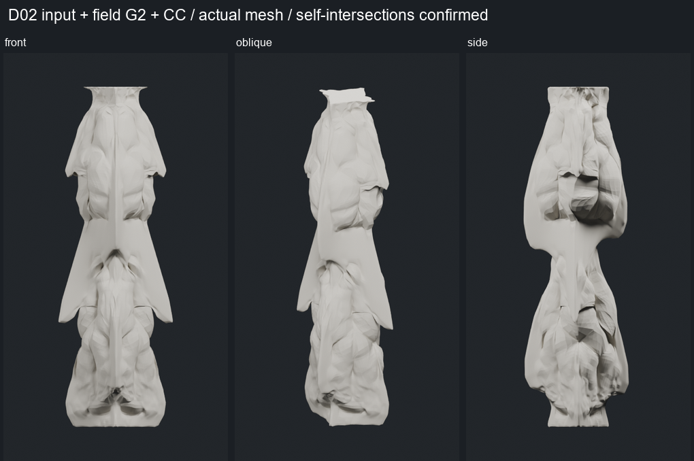

# IAAC / Mandelbulb 시험 — GPT 검토 자료

[**FOR_GPT.md에서 시작하세요.**](FOR_GPT.md)

기존 게이트 개발과 분리한 기둥 형상 시험입니다. 사용자가 긍정적으로 평가한 D02 입력 + 필드 G2 + CC를 중심으로, 입력/필드 분리 비교와 후속 매스 변형을 확인할 수 있습니다.

현재 형상은 실제 메시로 생성됐지만 **접힘선 기반 folding 구현은 아닙니다.** 유망 기준에 자기교차가 확인됐으며 제작 가능성은 미검증입니다.

- [짧은 평가](REPORT.md)
- [출처와 재구성의 경계](SOURCES.md)
- [공개 이미지·문서·검증 자료 목록](MANIFEST.json)
- [핵심 검사 기록](technical/validation_summary.json)
- [실패한 시도](technical/failed_trials.json)

원본 메시·전체 중간 세대·체크포인트·실행 환경은 로컬에 보존했습니다. 공개 자료만으로 직접 메시 재검증을 수행했다고 주장하지 마세요. 자동 후속 실행은 설정하지 않았습니다.
