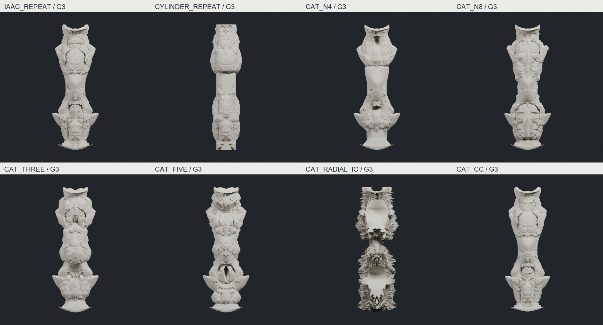

# IAAC 기반 컬럼 카탈로그 — 실제 반복 생성 G1–G3

**8개 흐름, 24개 후속 세대의 실제 메시를 생성했다.** 현재 베이스와 잔주름은 고정 조건에서 제외했다. 각 세대에서 실제 사각면을 4개로 나누고, 기존·신규 제어 정점을 모두 형상장에 반응시켰다. 주름 때문에 반복 수를 줄이지 않았다. 기존 후보와 원본 연산 코드는 보존했다.

| 흐름 | 적용한 차이 | 실제 형상에서 얻은 것 / 남은 문제 |
|---|---|---|
| IAAC_REPEAT | 접힌 입력, 지수 5·6의 형상장 2개 | 큰 접힘 위에 변화가 발달하지만 파편 같은 면이 많음 |
| CYLINDER_REPEAT | 동일 제어 토폴로지의 원통 입력 | 형상장 위치에 팽창부가 생김. 방향성 있는 골과 중간 연결부가 빈약함 |
| **CAT_N4** | 지수 4·4 | **깊은 열린 골과 큰 접힘이 가장 잘 읽힘.** 강점은 상당 부분 입력 형상에서 이어졌고, 새 디테일은 가장자리의 거친 피막에 가까움. 가운데 긴 구간의 발달은 약함 |
| CAT_N8 | 지수 8·8 | 팽창부의 폐곡선과 결속이 강해짐. 골이 방패 같은 면으로 닫혀 보이는 구간이 있음 |
| **CAT_THREE** | 형상장 3개, 지수 4·6·8 | **중간 몸통까지 질량과 접힘이 발달함.** 측면은 구형 마디가 적층된 인상이며, 정면의 일부 골은 메워짐. 거친 접합도 남음 |
| CAT_FIVE | 형상장 5개 | 전 높이로 사건이 확장됨. 반복 구간이 많아 위계가 균일해지는 경향 |
| CAT_RADIAL_IO | 내부는 축에서 바깥으로, 외부는 축 쪽으로 이동 | 실루엣은 크게 변하지만 규칙적인 가시·겹침이 지배함. 조형적 실패로 기록 |
| CAT_CC | 매 세대 실제 중립 Catmull–Clark 좌표 사용 | 일부 모서리는 완화되나, 이후 형상장 이동의 거친 면을 해소하지 못함. 자동 해법으로 추천하지 않음 |

[정면·사선·측면 비교 1](images/catalogue_views_1.png) · [비교 2](images/catalogue_views_2.png) · [N4 세대별 변화](images/CAT_N4_progression.png) · [3개 형상장 세대별 변화](images/CAT_THREE_progression.png). 다른 6개 흐름도 같은 형식의 progression을 images에 보존했다.

**후속 비교 대상으로 N4와 THREE를 추천한다.** N4는 깊은 공간을 남기는 방향, THREE는 중간 규모 질량을 재조직하는 방향이다. 어느 안도 IAAC의 정돈된 다중 접힘을 충분히 확보했다고 보지는 않는다. G2에서 G3로 갈 때 면은 세밀해졌지만, 새로운 큰 접힘의 발달은 작다. 단순한 복잡도 증가와 조형적 발전은 구분해야 한다.

## 공개 자료와 구현의 관계

[IAAC 사각면 도식](https://www.iaacblog.com/wp-content/uploads/2020/12/group-4_python-presentation.png)의 변 중점·면 중심 분할과 [내부 정점의 최근접 외부 격자점 이동 루프](https://www.iaacblog.com/wp-content/uploads/2020/12/group-4_python-presentation2.png)를 재구성했다. 기존 task33의 bilinear refinement를 사용하며, CC 비교안만 실제 CC 좌표를 유지한다. 별도 smoothing은 없다. [방사 이동 도식](https://www.iaacblog.com/wp-content/uploads/2020/12/group-4_python-presentation4.png)은 별도 비교안으로 구현했다.

확인한 공개 자료에서는 실행 코드·정확한 3D 방정식·이동 계수·격자 간격·Z 보정·곡선 attractor 수식을 확인하지 못했다. 따라서 구면 거듭제곱 Mandelbulb, 지수·배치·이동량은 **우리 재구성값**이다. 흐린 원본 숫자를 복원한 값으로 주장하지 않는다. 곡선 attractor와 frame/void subdivision은 이번 카탈로그에 적용하지 않았다.

G1–G3은 **메시 세분 + 형상장 갱신의 반복 횟수**다. 형상장 내부의 탈출 판정은 별도로 18회 반복한다. 제어 사각면은 6,208 → 24,832 → 99,328 → 397,312개이며, G3의 실제 렌더·검사 표면은 1,589,248개 삼각형이다. 후속 세대는 저장된 control_quad를 입력으로 사용한다. 렌더 전용 면 중심에는 독립 변형을 넣지 않았다.

## 핵심 검사와 보존

N4·THREE G3는 모두 좌우·앞뒤 실제 기하 반사 및 반사 삼각형 집합이 일치한다. 최대 반사 오차는 5.50e-15 이하, 연결체 1개, 폐합, 경계·비다양체 변 0, winding 일관이다. 최소 삼각형 면적은 각각 1.22e-8 / 5.97e-9로 기존 1e-12 기준을 통과했다.

**두 안 모두 CGAL 자기교차가 확인됐다.** 최초 교차 증거만 확인했으며 전체 교차 수는 계산하지 않았다. 다른 6개 G3의 자기교차는 미검사다. 모든 흐름의 실제 렌더와 세대별 유한 좌표·폐합·반사·최소 면적 기록은 보존했다. 두께·물리적 접힘 가능성·구조·제작 가능성은 미검증이다.

실제 메시·체크포인트·Blender 장면은 `E:/CHESHIRE_DATA/terminal_fold_20261011/`에 있다. [전체 위치 목록](INDEX.json) · [상세 수치](technical/catalogue_index.json) · [선별안 검사](technical/catalogue_validation.json) · [실행 코드](../../experiments/terminal_fold_20261011/README.md).

## 다음 단계에서 시험할 것 — 아직 미실행

현재 규칙은 고정된 형상장 내부 정점을 외부 경계 쪽으로 이동시킨다. 따라서 골 안의 정점도 밀려나 골이 메워질 수 있고, 경계에 가까워진 후에는 세분 횟수를 늘려도 새 큰 접힘이 자동으로 생기지 않는다. 고정 해상도의 목표 격자가 거친 피막을 만드는 데 얼마나 기여하는지는 아직 분리해 확인하지 않았다.

1. **N4의 작은 구간에서 목표 격자 해상도 비교.** 동일 입력·형상장을 두고 G2–G3의 외부점 격자를 정밀하게 해, 목표점의 불연속 이동이 줄고 작은 골이 연속적으로 드러나는지 확인한다. 이는 피막의 원인을 확인하는 비교이며 새로운 접힘을 확보했다고 간주하지 않는다.
2. **G0/G1에서 연결부의 되접힘과 형상장 중첩을 함께 설계.** 기존 방향별·축 위치별 return 연산으로 세 구간 사이에 길게 걸치는 골과 어깨를 만들고, 형상장의 위치·중첩 범위를 바꿔 후속 세분을 시험한다. N4의 열린 골과 THREE의 중간 질량을 참고하되, 초기 좌표를 고정하지 않는다. 정면·측면 모두에서 마디 사이에 새 골이 이어지는지를 판단한다.
